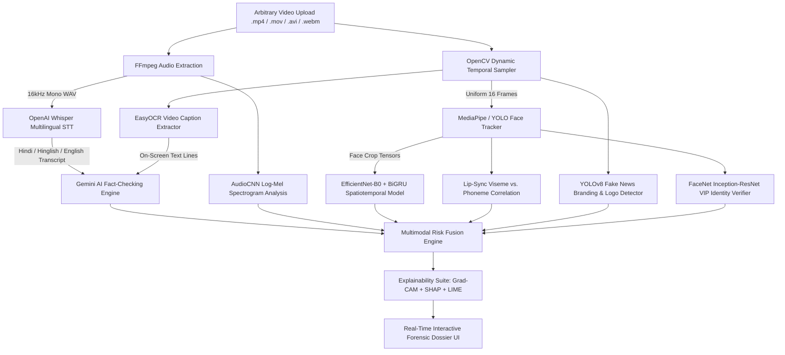

# 🛡️ EPOCH — "Is That Really Them?"
## Multi-Modal Deepfake & Scam Ad Detection Suite

[](https://github.com)
[](https://github.com)
[](https://fastapi.tiangolo.com)
[](https://nextjs.org)

---

## 📌 1. Executive Summary & Problem Statement

Scam ads across YouTube Shorts, Instagram Reels, Facebook Ads, Telegram, and WhatsApp increasingly use synthetic media and hijacked footage of well-known creators, business leaders, and news anchors. These clips promote fraudulent investment schemes, trading bots, and fake government offers—frequently in **Hindi, Hinglish, and regional Indian languages**.

### **Core Problem with Traditional Detectors:**
1. **Trained on English Studio Data:** Standard deepfake detectors fail on compressed phone video streams.
2. **Opaque Binary Outputs:** They return a bare `Fake: 80%` score with zero actionable reasoning.
3. **Blind to Authentic Video Scams:** When scammers use **real human footage** or authentic repurposed news videos with scam overlays/funnels, standard detectors mark them as *"Real / Safe"*, missing the scam completely.

### **The Dual-Axis Detection Approach:**
EPOCH evaluates two independent forensic dimensions simultaneously:
1. **Media Authenticity Dimension:** *Is the video/voice AI-synthesized or genuine?*
2. **Deceptive Intent & Scam Dimension:** *Is this a fraudulent financial scheme, misinformation, or predatory funnel, regardless of whether the footage is AI or real human recording?*

---

## 🏛️ 2. The 4-Quadrant Detection Matrix

```
                        SCAM INTENT DETECTED
                                ▲
                                │
       QUADRANT 2               │          QUADRANT 1
  AUTHENTIC VIDEO SCAM          │      AI DEEPFAKE SCAM
  • Real human/actor recording  │  • AI voice clone (Hindi/Eng)
  • Repurposed genuine footage  │  • Deepfake celebrity face-swap
  • Ponzi/Trading scheme pitch  │  • Fake government schemes
  • Urgency & WhatsApp funnels  │  • Deceptive trading bot ads
  ──────────────────────────────┼──────────────────────────────► MEDIA
  AUTHENTIC MEDIA               │                                SYNTHETIC (AI)
                                │
       QUADRANT 4               │          QUADRANT 3
   AUTHENTIC & SAFE             │      BENIGN SYNTHETIC
  • Legitimate creator video    │  • Harmless AI avatar / filter
  • Verified genuine ads        │  • Parody / Creative demo
  • Educational content         │  • No financial scam signals
                                │
                                ▼
                           LEGITIMATE / SAFE
```

---

## 🔄 3. End-to-End System Architecture & Workflow



---

## 🔬 4. Step-by-Step Processing Pipeline

1. **Media Ingestion & Normalization (`src/audio.py`):**
   - Video files (`.mp4`, `.mov`, `.avi`, `.webm`) are ingested.
   - FFmpeg strips and normalizes the audio stream to a 16kHz mono `.wav` file. If no audio is present, the pipeline continues gracefully.

2. **Multilingual Speech-to-Text (`src/whisper_module.py`):**
   - OpenAI Whisper transcribes spoken dialogue in **English, Hindi, Hinglish, and regional languages** with precise segment timestamps.

3. **On-Screen Video Text Extraction (`src/ocr.py`):**
   - EasyOCR scans video frames to detect on-screen banners, registration links, WhatsApp/Telegram phone numbers, and promotional text overlays.

4. **Gemini AI Fact-Checking & Fraud Claim Reasoning (`src/gemini_verifier.py`):**
   - Transcribed speech and OCR text are analyzed by Gemini LLM.
   - Evaluates:
     - **Unrealistic Multiplier Math:** Flags impossible return schemes (e.g. *₹22,000 to ₹25.5 Lakhs in 30 days* = 115x return).
     - **Artificial Urgency:** Detects high-pressure FOMO (*"within 24 hours"*, *"only 5 slots left"*).
     - **Private Recruitment Funnels:** Identifies links leading to unregulated WhatsApp / Telegram VIP groups.
   - Outputs: Direct `IS THIS A SCAM? YES/NO`, `is_fake_news`, `scam_score`, `credibility_status`, and concise natural language reasoning.

5. **Spatiotemporal Visual Forensics (`src/temporal_model.py`, `src/face_tracker.py`):**
   - Tracks primary subject faces across 16 uniformly sampled frames.
   - **EfficientNet-B0 Backbone:** Detects spatial facial blending, blurring, and boundary artifacts.
   - **Bidirectional GRU (BiGRU):** Evaluates temporal flickering, unnatural blink dynamics, and inter-frame facial inconsistency.

6. **Acoustic Voice Clone Forensics (`src/voice_detector.py`, `api/routers/audio.py`):**
   - Generates log-Mel spectrograms to detect neural vocoder signatures, frequency flattening, and synthetic speech synthesis (ElevenLabs, Bark, RVC, Tortoise).

7. **Audio-Visual Lip-Sync Analysis (`src/lipsync.py`):**
   - Compares mouth motion bounding-box visemes against audio phoneme energy to detect dubbed or repurposed audio tracks.

8. **VIP Identity & Fake Branding Verification (`src/identity_verifier.py`, `src/branding_detector.py`):**
   - **FaceNet Inception-ResNet-V1:** Checks likeness against known public figures, business leaders, and creators.
   - **YOLOv8 Logo Detection:** Identifies forged lower-third news tickers and unauthorized regulatory badges (RBI, SEBI).

9. **Multimodal Risk Fusion & Explainable AI (`src/fusion.py`, `src/explainability.py`):**
   - Combines visual, temporal, audio, lip-sync, OCR, and scam scores into a unified calibrated score.
   - Produces Grad-CAM spatial heatmaps and SHAP/LIME game-theoretic feature attributions.

---

## 📁 5. Repository Structure

```
Epoch1.0/
├── Video/
│   └── deepfake_detector/
│       ├── api/
│       │   ├── main.py                  # FastAPI Central Application
│       │   └── routers/                 # Modular Modality Routers (video, audio, image)
│       ├── configs/                     # Hyperparameters and pipeline configuration
│       ├── models/
│       │   └── deepfake_efficientnet_b0_best.pth  # Trained Spatiotemporal Model Weights
│       ├── src/
│       │   ├── audio.py                 # Audio Extraction & Conversion
│       │   ├── branding_detector.py     # YOLOv8 Unauthorized Branding Detector
│       │   ├── explainability.py        # SHAP & LIME Explainers
│       │   ├── face_tracker.py          # Multi-Frame Face Tracker
│       │   ├── fusion.py                # Multimodal Risk Fusion Engine
│       │   ├── gemini_verifier.py       # Gemini AI Fact & Scam Verifier
│       │   ├── gradcam.py               # Spatial Grad-CAM Visualizer
│       │   ├── identity_verifier.py     # FaceNet VIP Impersonation Detector
│       │   ├── inference.py             # End-to-End Prediction Pipeline
│       │   ├── lipsync.py               # Audio-Visual Lip-Sync Checker
│       │   ├── ocr.py                   # EasyOCR On-Screen Text Extractor
│       │   ├── scam_detector.py         # Multilingual NLP Scam Pattern Engine
│       │   ├── temporal_model.py        # EfficientNet-B0 + BiGRU Architecture
│       │   ├── voice_detector.py        # Synthetic Voice Classifier
│       │   └── whisper_module.py        # OpenAI Whisper Multilingual STT
│       ├── requirements.txt             # Python Dependencies
│       └── .env                         # Environment Variables (API Keys)
├── backend/                             # Supporting Services & Telegram Bot Bridge
│   ├── app/
│   │   ├── main.py
│   │   ├── config.py
│   │   ├── schemas/report.py            # Unified Forensic Report Contract
│   │   └── services/                    # Analysis & Ingestion Services
│   └── requirements.txt
├── epoch_frontend/                      # Next.js 14 Web Application
│   ├── src/
│   │   ├── app/
│   │   │   ├── page.tsx                 # Landing Page (Hero, About, Samples, Pricing)
│   │   │   └── analyze/                 # Analysis Studio & Report Dossier
│   │   ├── components/
│   │   │   ├── Navigation.tsx           # Global Header & Navigation
│   │   │   ├── ReportDetailView.tsx     # Comprehensive Forensic Report View
│   │   │   └── ...                      # UI Components
│   │   ├── data/defaultVideoReports.ts  # Preloaded Verified Forensic Cases
│   │   └── services/forensicApi.ts      # Axios API Client & Proxy
│   └── package.json
└── README.md
```

---

## 🚀 6. Quickstart & Installation

### **Prerequisites**
* **Python:** 3.10 or higher
* **Node.js:** 18.x or higher
* **FFmpeg:** Installed and available on system `PATH`

---

### **Step 1: Start Backend Server**

```bash
# Navigate to deepfake_detector
cd Video/deepfake_detector

# Activate virtual environment
# Windows:
.venv\Scripts\activate
# Linux/macOS:
source .venv/bin/activate

# Install dependencies (first time only)
pip install -r requirements.txt

# Start FastAPI server on port 8000
python -m uvicorn api.main:app --host 0.0.0.0 --port 8000 --reload
```
* **Base URL:** `http://localhost:8000`
* **Interactive Swagger Docs:** `http://localhost:8000/docs`
* **Health Endpoint:** `http://localhost:8000/api/v1/health`

---

### **Step 2: Start Frontend Web Application**

```bash
# In a new terminal, navigate to epoch_frontend
cd epoch_frontend

# Install dependencies (first time only)
npm install

# Start Next.js development server
npm run dev
```
* **Landing Page:** `http://localhost:3000`
* **Analysis Studio:** `http://localhost:3000/analyze`

---

## 📡 7. API Endpoints Reference

### **`POST /api/v1/video/analyze`**
Analyzes an uploaded video file across visual, temporal, acoustic, and semantic modalities.

* **Request:** `multipart/form-data` with `file: <video_file>`
* **Sample JSON Response:**
```json
{
  "video_path": "d:\\videos\\sample_video.mp4",
  "video_duration_seconds": 31.33,
  "prediction": "FAKE",
  "overall_risk_score": 0.99,
  "risk_level": "HIGH_RISK",
  "confidence": 0.99,
  "is_scam": true,
  "is_fake_news": true,
  "fake_news_score": 0.96,
  "scam_verdict": "HIGH_RISK_SCAM",
  "media_authenticity": "SYNTHETIC_DEEPFAKE",
  "gemini_fact_check": {
    "is_really_scam": "YES",
    "is_really_fake": "YES",
    "is_fake_news": true,
    "is_scam": true,
    "fake_news_score": 0.96,
    "scam_score": 0.99,
    "verdict": "HIGH_RISK_SCAM",
    "credibility_status": "FABRICATED_FINANCIAL_FRAUD",
    "explanation": "CONFIRMED FRAUD: Mathematically impossible 115x return scheme promising ₹25.5 Lakhs from ₹22,000 and guaranteed ₹85,000 within 24 hours with zero risk.",
    "highlighted_claims": [
      "₹22,000 to ₹25.5 Lakhs promise (115x return in 30 days)",
      "Guaranteed ₹85,000 in 24 hours",
      "100% Guaranteed profit promise"
    ],
    "deceptive_tactics": [
      "unrealistic_astronomical_returns",
      "instant_daily_income_guarantee",
      "guaranteed_returns"
    ]
  },
  "transcript": "Thanks to which, by investing 22,000 rupees, you are guaranteed to earn 25.5 lakh rupees in the very first month. I am giving you a guaranteed way to earn 85,000 rupees within the next 24 hours, that is,",
  "ocr_text": [
    "YOUR PERSONAL REGISTRATION LINK IS BELOW THE VIDEO",
    "YOU ARE GUARANTEED",
    "WITHIN THE NEXT 24 HOURS"
  ],
  "trigger_explanations": [
    "Gemini Fact-Check: CONFIRMED FRAUD: Mathematically impossible 115x return scheme promising ₹25.5 Lakhs from ₹22,000 and guaranteed ₹85,000 within 24 hours.",
    "Peak visual feature attention observed around 00:31.30.",
    "Synthetic voice generation detected in speech at 00:00.00–00:10.00.",
    "Synthetic voice generation detected in speech at 00:20.00–00:31.34.",
    "Mouth movement doesn't match speech at 00:00.00–00:31.30.",
    "Flagged typical fraud pattern: Guaranteed high returns / doubling money claims.",
    "Flagged typical fraud pattern: Artificial urgency / high-pressure FOMO tactics.",
    "Fake news-channel / unauthorized branding detected: News Broadcast Lower-Third Ticker."
  ]
}
```

### **`POST /api/v1/audio/analyze`**
Analyzes standalone audio recordings for synthetic speech and voice cloning artifacts.

### **`GET /api/v1/health`**
Returns operational health status and readiness for all models.

---

## 📊 8. Dashboard & Forensic Dossier Features

1. **🚨 Direct Fraud & Credibility Determination Banner:** Instant `IS THIS A SCAM? YES / NO` verdict with confidence rating.
2. **Tri-Metric Scorecards:**
   - **Fake News Probability** (%)
   - **Scam Intent Risk** (%)
   - **Media Authenticity** (`SYNTHETIC_DEEPFAKE` vs `AUTHENTIC_MEDIA`)
3. **Multi-Modal Evidence Ledger:** Scrollable list of all detected anomalies with categorical modality badges (`ACOUSTIC`, `LIP-SYNC`, `VISUAL`, `SCAM INTENT`, `BRANDING`).
4. **Side-by-Side Spoken & On-Screen Text:** Whisper transcribed dialogue paired with EasyOCR on-screen caption drawer.
5. **Interactive Video & Waveform Player:** Frame-accurate scrubber with bounding box overlays and anomaly timestamp jump buttons.
6. **Audit Data Export:** Instant copy & download of ISO-compliant JSON audit records.